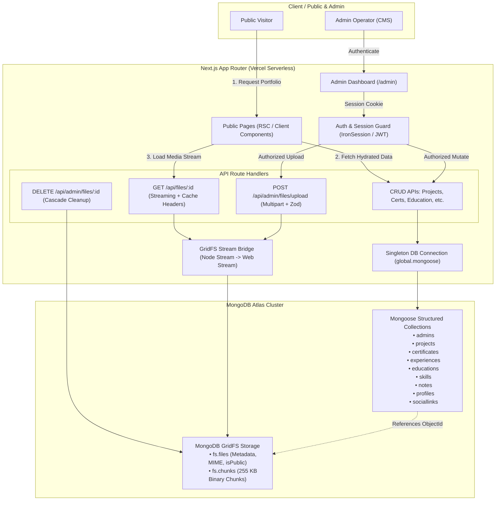

# 🏛️ Sachithra Portfolio — Architectural Blueprint & Master Implementation Plan

> **Executive Directive**: Complete elimination of Cloudflare R2, AWS S3, Cloudinary, and all external object storage services. MongoDB Atlas is established as the **sole, unified source of truth** for both structured relational-style document data (Mongoose) and binary media assets (MongoDB GridFS).

---

## 1. 🎓 Conceptual Masterclass: Philosophy, First Principles & Landscape

### 1.1 The Core Problem & Architectural Shift
In multi-cloud portfolio architectures, developers frequently introduce dedicated object stores (e.g., Cloudflare R2, AWS S3) alongside their operational database. While object storage excels at massive, petabyte-scale media delivery, it introduces severe friction for high-velocity personal portfolios and headless CMS platforms:

1. **Dual-Brain Synchronization Fragility**: Database records (e.g., a Project document) and file blobs (e.g., an S3/R2 image object) live in isolated systems with no transactional boundaries. When an upload succeeds but a database write fails (or vice versa), the system produces orphaned objects or broken dangling URLs.
2. **Operational Overkill & Credential Sprawl**: Maintaining multi-cloud IAM roles, bucket policies, R2 access key IDs, secret keys, endpoint URLs, and custom domain SSL certs adds unnecessary operational surface area.
3. **Egress & Ingress Boundary Inconsistencies**: Routing traffic through multiple cloud vendors introduces disjointed caching policies, differing CORS behaviors, and cross-origin authentication headaches.

By migrating exclusively to **MongoDB Atlas with MongoDB GridFS**, we unify our storage model into a single atomic persistence engine.

---

### 1.2 The Physics of MongoDB GridFS
MongoDB document size is strictly capped at **16MB (BSON specification limit)** to keep memory allocation deterministic and cache invalidation fast in the WiredTiger storage engine. Binary files (such as high-resolution screenshots, certificate PDFs, and resumes) often exceed or dangerously approach this limit. 

GridFS solves this through an elegant, low-level chunking abstraction implemented directly within the database:

```
                            [ Incoming Binary Stream ]
                                        │
                       ┌────────────────┴────────────────┐
                       ▼                                 ▼
              [ fs.files collection ]          [ fs.chunks collection ]
              ┌─────────────────────┐          ┌──────────────────────┐
              │ _id: ObjectId       │          │ _id: ObjectId        │
              │ filename: String    │◄─────────┼─files_id: ObjectId   │
              │ length: Number      │          │ n: 0 (Chunk Index)   │
              │ chunkSize: 255 KB   │          │ data: BinData (raw)  │
              │ uploadDate: Date    │          └──────────────────────┘
              │ metadata: {         │          ┌──────────────────────┐
              │   mimeType: String  │◄─────────┼─files_id: ObjectId   │
              │   isPublic: Boolean │          │ n: 1 (Chunk Index)   │
              │   uploadedBy: Id    │          │ data: BinData (raw)  │
              │ }                   │          └──────────────────────┘
              └─────────────────────┘
```

- **`fs.files`**: Stores the metadata envelope of the file (name, size, chunk size [default 255 KB], upload timestamp, MIME type, and access permission flags).
- **`fs.chunks`**: Stores the actual binary payload partitioned into sequential 255 KB binary chunks with a compound index `{ files_id: 1, n: 1 }`.
- **Zero-Copy Streaming**: Rather than loading multi-megabyte buffers into Node.js/Vercel serverless RAM, GridFS uses `GridFSBucketReadStream` and `GridFSBucketWriteStream`. In Next.js App Router, these native Node.js streams are bridged to Web API `ReadableStream` instances, enabling **zero-memory-buffering streaming** directly over HTTP.

---

### 1.3 Comparative Matrix: R2 vs. MongoDB GridFS

| Dimension | Cloudflare R2 / AWS S3 | MongoDB Atlas GridFS (Our Target) |
| :--- | :--- | :--- |
| **Storage Engine** | Proprietary Object Storage | MongoDB Atlas (WiredTiger + GridFS Bucket) |
| **Network Endpoints** | Multiple (DB URI + R2 S3 API Endpoint) | Single Unified `MONGODB_URI` |
| **Credential Management** | 5+ keys (AccessKey, Secret, Bucket, Endpoint, Token) | 1 Connection String (`MONGODB_URI`) |
| **Referential Integrity** | Loose / Manual Webhooks | Native `ObjectId` referential integrity |
| **Garbage Collection** | S3 Lifecycle Rules / Orphaned Blobs | Atomic cascading deletion in Mongoose hooks |
| **Serverless Integration** | Requires AWS SDK v3 bundle (~15MB overhead) | Native `mongodb` driver (zero extra storage SDKs) |
| **Vercel Compatibility** | Presigned URLs / direct uploads | Next.js Streaming Route Handlers (`/api/files/[id]`) |

---

## 2. 🔍 Surgical Critique & Red Teaming (What Could Break?)

### 2.1 Failure Vector 1: Vercel Serverless Function 4.5 MB Request Body Limit
* **The Threat**: Vercel Serverless Functions enforce a strict **4.5 MB request payload limit** for API Route Handlers on Hobby accounts. If an admin attempts to upload a 10 MB raw uncompressed screenshot or a high-res PDF portfolio catalog via a single POST request, Vercel immediately terminates the request with `413 FUNCTION_PAYLOAD_TOO_LARGE` before Next.js code even executes.
* **The Defense**:
  1. Enforce a strict client-side and server-side validation limit of **4 MB per image** and **10 MB per PDF**.
  2. Implement client-side image compression (Canvas/WebP downsampling) in the Admin CMS before dispatching multipart requests.
  3. Validate file magic numbers (signatures) on the server to reject corrupted or disguised binaries.

### 2.2 Failure Vector 2: Serverless Connection Pool Exhaustion in Next.js
* **The Threat**: Each Vercel Serverless execution environment spins up independently. If route handlers establish a fresh `mongoose.connect()` on every incoming request, a sudden burst of image reads could exhaust the connection limits of the MongoDB Atlas shared cluster (M0/M2/M5 tiers limit concurrent connections between 100 and 500).
* **The Defense**:
  - Implement the **Global Mongoose & MongoClient Singleton Cache** pattern in `lib/db/mongodb.ts`. Cached connection promises persist across warm lambda invocations, capping connection churn to 1–2 per warm container.

### 2.3 Failure Vector 3: Memory Spikes via In-Memory Buffering
* **The Threat**: Beginners frequently use `await file.arrayBuffer()` or `Buffer.from()` inside Next.js route handlers. When 20 concurrent visitors request project cover images, reading complete files into memory simultaneously causes memory bloat, leading to Vercel memory exhaustion (`1024 MB limit exceeded`) and lambda crashes.
* **The Defense**:
  - We strictly enforce **GridFS download streams piped directly to `NextResponse` Web Streams**. Chunks flow through memory in 255 KB increments and are immediately flushed over the HTTP socket.

### 2.4 Failure Vector 4: Ghost Blobs & Orphaned GridFS Chunks
* **The Threat**: When an admin updates a Project and replaces `coverImageId` with a new file, the old file in `fs.files` and its corresponding chunks in `fs.chunks` remain permanently stranded in Atlas unless explicitly destroyed. Over months, this bloats database storage.
* **The Defense**:
  - Implement a dedicated `deleteGridFSFile(fileId: ObjectId)` service.
  - Wire Mongoose `pre('save')` and `post('findOneAndDelete')` hooks into the `Project`, `Certificate`, and `Profile` models to automatically purge superseded file IDs.

### 2.5 Failure Vector 5: CDN & Browser Cache Starvation
* **The Threat**: Serving dynamic images from an API endpoint (`/api/files/[id]`) without proper HTTP caching headers causes browsers to re-download images on every page navigation, spiking database bandwidth and degrading Lighthouse performance.
* **The Defense**:
  - Return HTTP headers:
    - `Cache-Control: public, max-age=31536000, immutable` (since GridFS file IDs are immutable ObjectIds; replacement generates a new ID).
    - `ETag: file._id.toString()`
    - `Content-Type: file.metadata.mimeType`
    - `Content-Disposition: inline` for images/preview PDFs, or `attachment; filename="..."` for CV downloads.
    - Support HTTP `304 Not Modified` when `If-None-Match` matches `file._id`.

### 2.6 Anti-Scope Creep Filter (Strict Non-Goals)
* ❌ NO secondary cloud storage (no R2, no S3, no Cloudinary, no Supabase Storage).
* ❌ NO Base64 encoding inside standard documents (Base64 bloats payload by 33% and ruins Mongoose document traversal).
* ❌ NO client-side direct MongoDB connections (all access mediated by secure Next.js Server Actions and Route Handlers).
* ❌ NO external GraphQL or Apollo server layer (Next.js App Router + typed REST endpoints provide maximum performance and lowest latency).

---

## 3. 🗺️ Implementation Plan Blueprint & State Contracts

### 3.1 Architectural Flow Diagram



---

### 3.2 Data Models & Schema Contracts (Mongoose)

#### 1. File Metadata Contract (`fs.files.metadata`)
```typescript
export interface IFileMetadata {
  originalName: string;
  mimeType: string;
  size: number;
  uploadedBy: mongoose.Types.ObjectId; // Ref: Admin
  isPublic: boolean;
  documentType: 
    | 'profile-avatar'
    | 'project-cover'
    | 'project-gallery'
    | 'certificate-image'
    | 'certificate-pdf'
    | 'experience-logo'
    | 'cv-pdf';
}
```

#### 2. Project Collection (`projects`)
```typescript
import mongoose, { Schema, Document } from 'mongoose';

export interface IProject extends Document {
  title: string;
  slug: string;
  description: string;
  longDescription?: string;
  coverImageId: mongoose.Types.ObjectId;      // GridFS file ID
  galleryImageIds: mongoose.Types.ObjectId[]; // GridFS file IDs
  technologies: string[];
  githubUrl?: string;
  liveUrl?: string;
  status: 'completed' | 'in-progress' | 'archived';
  featured: boolean;
  order: number;
  createdAt: Date;
  updatedAt: Date;
}

const ProjectSchema = new Schema<IProject>({
  title: { type: String, required: true, trim: true },
  slug: { type: String, required: true, unique: true, lowercase: true, trim: true },
  description: { type: String, required: true },
  longDescription: { type: String },
  coverImageId: { type: Schema.Types.ObjectId, required: true },
  galleryImageIds: [{ type: Schema.Types.ObjectId }],
  technologies: [{ type: String, trim: true }],
  githubUrl: { type: String, trim: true },
  liveUrl: { type: String, trim: true },
  status: { type: String, enum: ['completed', 'in-progress', 'archived'], default: 'completed' },
  featured: { type: Boolean, default: false },
  order: { type: Number, default: 0 },
}, { timestamps: true });

ProjectSchema.index({ order: 1, featured: -1 });
```

#### 3. Certificate Collection (`certificates`)
```typescript
export interface ICertificate extends Document {
  title: string;
  issuer: string;
  issueDate: Date;
  description: string;
  credentialUrl?: string;
  coverImageId: mongoose.Types.ObjectId; // GridFS file ID (PNG/JPG preview)
  fileId?: mongoose.Types.ObjectId;       // GridFS file ID (PDF credential document)
  order: number;
}

const CertificateSchema = new Schema<ICertificate>({
  title: { type: String, required: true },
  issuer: { type: String, required: true },
  issueDate: { type: Date, required: true },
  description: { type: String, required: true },
  credentialUrl: { type: String },
  coverImageId: { type: Schema.Types.ObjectId, required: true },
  fileId: { type: Schema.Types.ObjectId },
  order: { type: Number, default: 0 }
}, { timestamps: true });
```

#### 4. Experience Collection (`experiences`)
```typescript
export interface IExperience extends Document {
  company: string;
  role: string;
  location: string;
  startDate: Date;
  endDate?: Date;
  current: boolean;
  description: string;
  achievements: string[];
  logoFileId?: mongoose.Types.ObjectId; // GridFS file ID
  order: number;
}
```

#### 5. Education Collection (`educations`)
```typescript
export interface IEducation extends Document {
  institution: string;
  degree: string;
  fieldOfStudy: string;
  startDate: Date;
  endDate?: Date;
  current: boolean;
  grade?: string;
  description: string;
  achievements: string[];
  logoFileId?: mongoose.Types.ObjectId; // GridFS file ID
  order: number;
}
```

#### 6. Skill Collection (`skills`)
```typescript
export interface ISkill extends Document {
  name: string;
  category: 'Frontend' | 'Backend' | 'Mobile' | 'Cloud & DevOps' | 'Database' | 'Tools';
  proficiency?: number; // 0 - 100
  iconName?: string;     // Lucide icon identifier or SVG symbol
  order: number;
}
```

#### 7. Profile Collection (`profiles`)
```typescript
export interface IProfile extends Document {
  fullName: string;
  title: string;
  headline: string;
  bio: string;
  location: string;
  email: string;
  phone?: string;
  avatarImageId?: mongoose.Types.ObjectId; // GridFS file ID
  resumeFileId?: mongoose.Types.ObjectId;  // GridFS file ID (Current CV PDF)
  availableForHire: boolean;
}
```

#### 8. Admin Collection (`admins`)
```typescript
export interface IAdmin extends Document {
  email: string;
  passwordHash: string;
  role: 'superadmin' | 'editor';
  lastLogin?: Date;
}
```

#### 9. SocialLink & Note Collections (`sociallinks`, `notes`)
- `SocialLink`: `{ platform: string, url: string, icon: string, order: number, isPublic: boolean }`
- `Note`: `{ title: string, slug: string, content: string, tags: [string], published: boolean, coverImageId?: ObjectId, publishedAt: Date }`

---

### 3.3 Streaming File Route Handler Specification

#### 1. `GET /api/files/[id]` (Controlled Public Streaming)
```typescript
// app/api/files/[id]/route.ts
import { NextRequest, NextResponse } from 'next/server';
import { getGridFSBucket, getDatabase } from '@/lib/db/mongodb';
import mongoose from 'mongoose';
import { Readable } from 'stream';

export async function GET(
  req: NextRequest,
  { params }: { params: { id: string } }
) {
  const { id } = params;
  if (!mongoose.Types.ObjectId.isValid(id)) {
    return NextResponse.json({ error: 'Invalid file ID' }, { status: 400 });
  }

  const fileObjectId = new mongoose.Types.ObjectId(id);
  const db = await getDatabase();
  const bucket = await getGridFSBucket();

  const fileDoc = await db.collection('fs.files').findOne({ _id: fileObjectId });
  if (!fileDoc) {
    return NextResponse.json({ error: 'File not found' }, { status: 404 });
  }

  // Access Control: If private document, verify admin session
  if (fileDoc.metadata?.isPublic === false) {
    const isAuthed = await verifyAdminSession(req);
    if (!isAuthed) {
      return NextResponse.json({ error: 'Unauthorized' }, { status: 401 });
    }
  }

  // HTTP Caching & Conditional 304 Not Modified
  const etag = `"${fileDoc._id.toString()}"`;
  const clientEtag = req.headers.get('if-none-match');
  if (clientEtag === etag) {
    return new NextResponse(null, { status: 304 });
  }

  // Convert Node.js GridFSReadStream to Web API ReadableStream
  const nodeStream = bucket.openDownloadStream(fileObjectId);
  const webStream = new ReadableStream({
    start(controller) {
      nodeStream.on('data', (chunk) => controller.enqueue(chunk));
      nodeStream.on('end', () => controller.close());
      nodeStream.on('error', (err) => controller.error(err));
    },
    cancel() {
      nodeStream.destroy();
    }
  });

  const contentType = fileDoc.metadata?.mimeType || 'application/octet-stream';
  const disposition = req.nextUrl.searchParams.get('download') === 'true'
    ? `attachment; filename="${encodeURIComponent(fileDoc.filename)}"`
    : 'inline';

  return new NextResponse(webStream, {
    status: 200,
    headers: {
      'Content-Type': contentType,
      'Content-Length': fileDoc.length.toString(),
      'Content-Disposition': disposition,
      'ETag': etag,
      'Cache-Control': 'public, max-age=31536000, immutable',
    },
  });
}
```

#### 2. `POST /api/admin/files/upload` (Protected Multipart Handler)
```typescript
// app/api/admin/files/upload/route.ts
import { NextRequest, NextResponse } from 'next/server';
import { getGridFSBucket } from '@/lib/db/mongodb';
import { verifyAdminSession } from '@/lib/auth/session';
import { z } from 'zod';

const ALLOWED_MIME_TYPES = [
  'image/jpeg',
  'image/png',
  'image/webp',
  'image/svg+xml',
  'application/pdf',
];

const MAX_IMAGE_SIZE = 4 * 1024 * 1024; // 4 MB (Vercel payload compliant)
const MAX_PDF_SIZE = 10 * 1024 * 1024;  // 10 MB

export async function POST(req: NextRequest) {
  const session = await verifyAdminSession(req);
  if (!session) {
    return NextResponse.json({ error: 'Unauthorized' }, { status: 401 });
  }

  const formData = await req.formData();
  const file = formData.get('file') as File | null;
  const documentType = (formData.get('documentType') as string) || 'project-gallery';
  const isPublic = formData.get('isPublic') !== 'false';

  if (!file) {
    return NextResponse.json({ error: 'No file provided' }, { status: 400 });
  }

  if (!ALLOWED_MIME_TYPES.includes(file.type)) {
    return NextResponse.json({ error: `Unsupported MIME type: ${file.type}` }, { status: 415 });
  }

  const maxAllowed = file.type === 'application/pdf' ? MAX_PDF_SIZE : MAX_IMAGE_SIZE;
  if (file.size > maxAllowed) {
    return NextResponse.json({ error: `File exceeds maximum size of ${maxAllowed / (1024 * 1024)}MB` }, { status: 413 });
  }

  const bucket = await getGridFSBucket();
  const buffer = Buffer.from(await file.arrayBuffer());

  const uploadStream = bucket.openUploadStream(file.name, {
    metadata: {
      originalName: file.name,
      mimeType: file.type,
      size: file.size,
      uploadedBy: session.adminId,
      isPublic,
      documentType,
    },
  });

  await new Promise<void>((resolve, reject) => {
    uploadStream.end(buffer, (err) => {
      if (err) reject(err);
      else resolve();
    });
  });

  return NextResponse.json({
    success: true,
    fileId: uploadStream.id.toString(),
    url: `/api/files/${uploadStream.id.toString()}`,
    filename: file.name,
    mimeType: file.type,
    size: file.size,
  }, { status: 201 });
}
```

---

### 3.4 File Mutation Manifest

| Action | Target Path | Single Responsibility Rationale |
| :--- | :--- | :--- |
| `[NEW]` | `.env.example` | Clean documentation of canonical environment variables without R2 |
| `[NEW]` | `ARCHITECTURE_PLAN.md` | Persistent architectural contract and engineering reference in project root |
| `[NEW]` | `src/lib/db/mongodb.ts` | Global Mongoose and GridFSBucket singleton connection pool manager |
| `[NEW]` | `src/models/*.ts` | 9 Mongoose schemas (`Admin`, `Project`, `Certificate`, `Experience`, `Education`, `Skill`, `Profile`, `Note`, `SocialLink`) |
| `[NEW]` | `src/app/api/files/[id]/route.ts` | Controlled, streamed public GridFS media retrieval endpoint with caching |
| `[NEW]` | `src/app/api/admin/files/upload/route.ts` | Authenticated multipart upload endpoint with MIME and size bounds |
| `[NEW]` | `src/app/api/admin/files/[id]/route.ts` | Hard deletion endpoint to purge GridFS chunks and files |
| `[NEW]` | `src/scripts/seed_portfolio_data.ts` | Seed script to ingest local assets (`public/Photos`, `public/certifications`, `public/CV`) into GridFS and MongoDB |
| `[MODIFY]` | `package.json` | Add `mongoose`, `zod`, `jose` / `iron-session`; ensure zero R2/AWS dependencies |
| `[MODIFY]` | `src/components/ProjectsSection.tsx` | Connect project data consumption to Next.js API or Server Components |

---

## 4. 🧪 Validation Protocol & Ground Truth Verification

### 4.1 Automated Validation Suite
1. **GridFS Round-Trip Stream Test**:
   - Upload a test 500 KB PNG file through the upload stream.
   - Verify `fs.files` record contains matching metadata and `fs.chunks` contains `Math.ceil(500KB / 255KB) = 2` chunk documents.
   - Fetch the file via `GET /api/files/[id]` and assert byte-for-byte stream equivalence (SHA-256 checksum equality).
2. **Payload Boundary Enforcement Test**:
   - Send a 5 MB image to `/api/admin/files/upload` $\to$ verify response is `413 Payload Too Large`.
   - Send an `.exe` disguised as `.png` $\to$ verify MIME validation returns `415 Unsupported Media Type`.
3. **Cascading File Cleanup Test**:
   - Create a Project with a cover image.
   - Delete the Project via admin API.
   - Query `fs.files` and `fs.chunks` with the deleted `coverImageId` $\to$ assert 0 documents exist (no orphaned chunks).

### 4.2 Asset Migration Verification (Seeding Script)
Execute `npx ts-node src/scripts/seed_portfolio_data.ts` and verify:
- All 18 existing images from `public/Photos/` are ingested into GridFS.
- All 5 certificate images and 5 certificate PDFs from `public/certifications/` are ingested into GridFS with correct MIME types.
- The resume PDF from `public/CV/Sachithra Indrachapa's Resume.pdf` is ingested into GridFS and linked to `Profile.resumeFileId`.
- Existing portfolio pages render every image flawlessly using `/api/files/:id`.

---

## 5. 🔄 Rollback Strategy & Failure Containment

### 5.1 Instant Rollback Path (< 60 Seconds)
1. **Static Fallback Preservation**:
   - Retain the static assets inside `public/Photos/`, `public/certifications/`, and `public/CV/` as a permanent fallback directory.
   - If MongoDB Atlas experiences a network outage, client image components feature a dual-resolution fallback:
     ```tsx
      { e.currentTarget.src = project.fallbackLocalPath; }}
     />
     ```
2. **Git Reversion**:
   - Reverting to commit `bbd4d0f` on branch `feature/portfolio_admin_cms` immediately restores the pure static Vite React deployment without disruption.

### 5.2 Atlas Disaster Recovery & Maintenance
- Automated daily Atlas snapshot backup enabled via Atlas dashboard.
- M0/M2 cluster upgrade path documented if connection limits need horizontal expansion.
